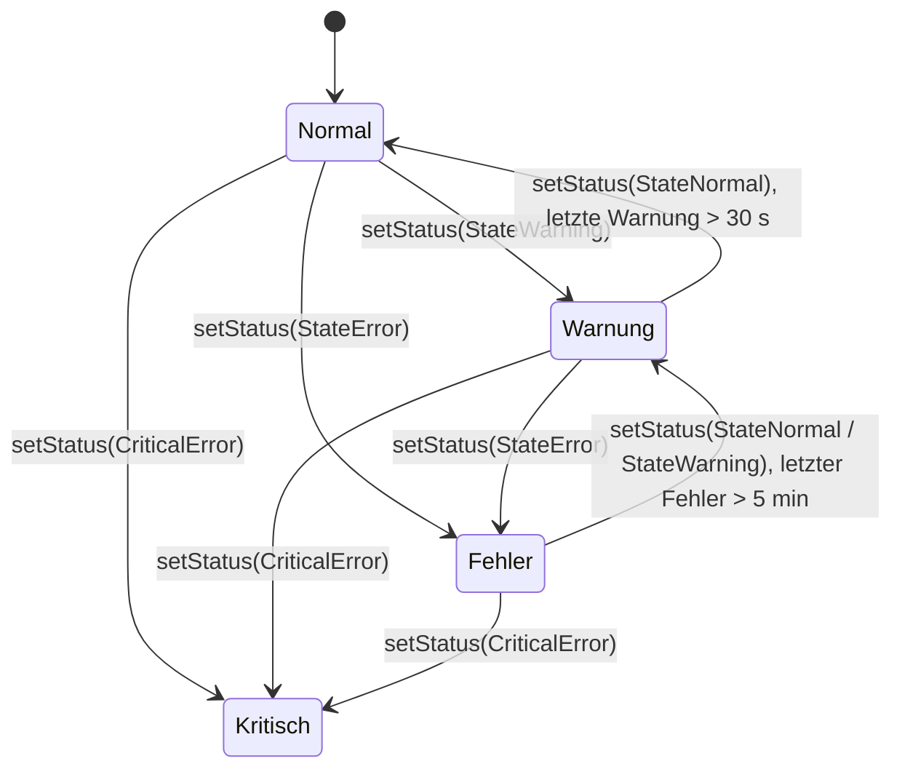

# STM32 Zustandsmaschine

Eine modulare, in C implementierte Zustandsmaschine für STM32-Mikrocontroller in
Fahrzeuganwendungen. Sie verwaltet den Betriebszustand vom Start bis zum Abschalten und
einen Fehlerstatus mit zeitverzögertem Zurücksetzen. Zustandswechsel werden über UART
ausgegeben.

## Beschreibung

Die Bibliothek verwaltet alle relevanten Betriebszustände eines Fahrzeugs, vom Startvorgang
über den Fahrbetrieb bis zum kontrollierten Abschalten, und verbindet sie mit einem
Fehler- und Warnungsmanagement.

Zustand und Fehlerstatus liegen zusammen in einem einzigen Byte, der Union `Statemaschine`:
Die unteren 4 Bit enthalten den Zustand, die oberen 4 Bit je ein Flag für Normal, Warnung,
Fehler und kritischen Fehler. Dadurch lassen sich Zustand und Diagnose gleichzeitig und
ressourcenschonend abfragen, einzeln über die Bitfelder oder gemeinsam über `Status`.

## Dateien

| Datei             | Beschreibung                                                          |
|-------------------|-----------------------------------------------------------------------|
| `statemaschine.h` | Zustände, Union `Statemaschine`, Konstanten, Versions-Defines, API    |
| `statemaschine.c` | Implementierung von `setState()` und `setStatus()`                    |

## Konfigurationsparameter

| Define                | Standard | Beschreibung                                                   |
|-----------------------|----------|----------------------------------------------------------------|
| `ERROR_RESET`         | 300000   | Zeit in ms (5 min) ohne Fehler, bevor ein Fehler zurückgestuft wird |
| `WARNING_RESET`       | 30000    | Zeit in ms (30 s) ohne Warnung, bevor eine Warnung zurückgesetzt wird |
| `STANDBYTIME`         | 300000   | Standby-Zeit in ms (5 min) nach dem Ausschalten von KL15, zur Verwendung in der Anwendung |
| `DEBUG_STATEMASCHINE` | –        | wird automatisch gesetzt, wenn `DEBUG` definiert ist           |

## Zustände

| Zustand        | Wert | Beschreibung                                      |
|----------------|------|---------------------------------------------------|
| `Start`        | 0    | Systemstart, Initialisierung                      |
| `Ready`        | 1    | System gestartet und betriebsbereit               |
| `KL15`         | 2    | Zündung aktiv (KL15)                              |
| `Anlassen`     | 3    | Anlasser betätigt                                 |
| `Precharge`    | 4    | Vorladung des Fahrzeugsystems                     |
| `ReadyToDrive` | 5    | System bereit für den Fahrbetrieb                 |
| `Drive`        | 6    | Fahrzeug im Fahrmodus                             |
| `Standby`      | 7    | Abschaltvorgang eingeleitet (Zeitverzögerung)     |
| `Ausschalten`  | 8    | System wird vollständig abgeschaltet              |
| `Laden`        | 9    | Lademodus aktiv                                   |

Die Bibliothek prüft keine Übergänge zwischen den Zuständen. Welcher Zustand auf welchen
folgt, legt die Anwendung fest.

## Fehlerstatus

| Status          | Wert | Beschreibung                   |
|-----------------|------|--------------------------------|
| `StateNormal`   | 0x10 | Normalbetrieb, kein Fehler     |
| `StateWarning`  | 0x20 | Warnung aktiv                  |
| `StateError`    | 0x40 | Fehler aktiv                   |
| `CriticalError` | 0x80 | Kritischer Fehler              |

### Fehlerverhalten



- **Warnungen** bleiben mindestens **30 Sekunden** nach ihrem letzten Auftreten gesetzt,
  auch wenn die Ursache zwischenzeitlich nicht mehr vorliegt.
- **Fehler** bleiben mindestens **5 Minuten** nach ihrem letzten Auftreten gesetzt. Danach
  wird der Status zunächst auf Warnung zurückgestuft und erst nach weiteren 30 Sekunden
  auf Normal.
- **Kritische Fehler** werden von `setStatus()` nie zurückgesetzt.
- Ein ungültiger Statuswert setzt einen kritischen Fehler und gibt eine Meldung über UART aus.

Dieses Verhalten verhindert, dass kurzzeitig auftretende Probleme unbemerkt bleiben.

## API

```c
void setState (uint8_t state);                 // Betriebszustand setzen und über UART ausgeben
void setStatus (uint8_t status);               // Fehlerstatus setzen

extern Statemaschine Main_Statemaschine;       // Aktueller Zustand und Fehlerstatus
```

## Verwendung

### 1. Dateien einbinden

`statemaschine.h` und `statemaschine.c` in das STM32-Projekt kopieren und den Header
einbinden:

```c
#include "statemaschine.h"
```

Eine Initialisierung ist nicht nötig. `Main_Statemaschine` steht nach dem Start im Zustand
`Start` mit dem Status `StateNormal`.

### 2. Zustand setzen

```c
setState(Ready);
```

### 3. Fehlerstatus melden

`setStatus()` wird zyklisch mit dem aktuellen Ergebnis der Diagnose aufgerufen, damit die
Zeiten für das Zurücksetzen ablaufen können:

```c
if (fehler)
{
	setStatus(StateError);
}
else
{
	setStatus(StateNormal);
}
```

### 4. Zustand und Status abfragen

```c
if ((Main_Statemaschine.State == Drive) && Main_Statemaschine.Error)
{
	// Fahrbetrieb mit aktivem Fehler
}
```

## Hinweise

- `setState(Start)` wird ignoriert, der Zustand `Start` liegt nur nach dem Systemstart vor.
- Die UART-Ausgabe erfolgt über `uartTransmit()` aus `basicuart.h`. Ohne `DEBUG` bleibt sie
  stumm, da `basicuart` dann keine Daten sendet.

## Abhängigkeiten

- `main.h` – STM32 HAL
- [`basicuart.h`](https://github.com/Diveturtle93/STM32_Basicuart) – Ausgabe der Zustandswechsel über UART
- [`millis.h`](https://github.com/Diveturtle93/STM32_Millis) – Zeitbasis für das Zurücksetzen von Fehler und Warnung

## Lizenz

Dieses Projekt steht unter der [GPL-3.0 Lizenz](LICENSE).
